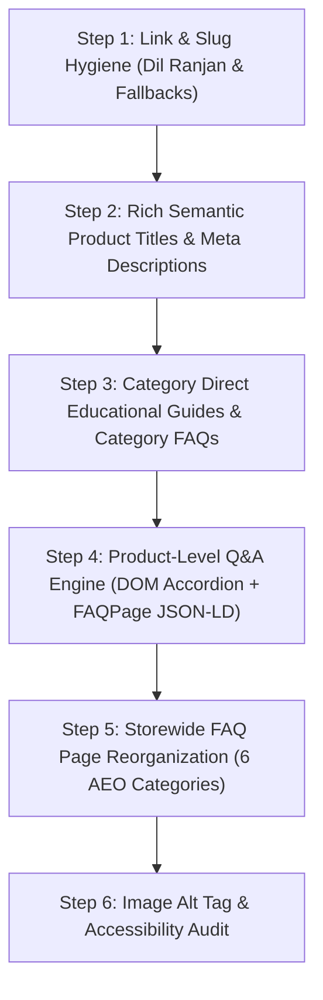

# HIYAGHAR – AEO & SEO Implementation Plan (Code-Side Execution)

**Target:** Answer Engine Optimization (AEO) & Search Engine Optimization (SEO)  
**Scope:** 100% Code & Database implementation (No Blog / No External Content Hub)  
**Status:** All code done (Steps 1–6). Remaining work is content only: guide answers, product Q&A, category guide text, confirmed product facts  
**Last updated:** 17 Nov 2026  

> **Do not use this file for answer text.** Facts written below (tobacco/supari-free, preservative-free,
> tea masala and soap ingredients, FSSAI number) are not confirmed. Answer text must come from the
> full AEO Implementation Guide or the product data in the database.

## Status at a glance (17 Nov 2026)

| Step | What | Status |
|---|---|---|
| 1 | Link & slug cleanup | ✅ Done: 301s for `/product/dil-rajan` and `/product/dil-rajan-mukhwas` (`Program.cs`, `App.tsx`); sitemap, canonical and cards use `/product/dil-ranjan`; `Header.tsx` search fallback now says `'Dil Ranjan'` |
| 2 | Product titles & meta descriptions | ✅ Code done: titles are `{Name} {Category} \| HIYAGHAR` from the database category ("Choco Masti Mukhwas \| HIYAGHAR"; left out when the name already says it), same rule on the server (`SeoMarkup.ProductTitle`) and the page (`buildProductSeoTitle`). **Pending (content):** a confirmed key feature per product and longer meta descriptions |
| 3 | Category guides & category FAQs | ✅ Code done: `CategoryGuide` section on the 6 category pages + crawlable HTML + `FAQPage` JSON-LD, all from the `"guide"` entry of each route in `seo/routes.json` (heading, paragraphs, faqs). Hidden until text is added. **Pending (content):** the guide text and FAQs |
| 4 | Product-level Q&A | ✅ Feature built (Admin → Products → FAQs; `
` in the page + `FAQPage` JSON-LD from the server). **Pending:** enter 3–5 answers per product (from the guide) |
| 5 | `/faq` reorganization | ✅ Code done: 6 categories (About HIYAGHAR, Mukhwas, Tea Masala, Soaps & Hair Oil, Gifting & Combos, Ordering, Shipping & Payment) from `seo/routes.json` `faqCategories`, used by the FAQ page, Admin → FAQ Management and the server HTML/JSON-LD; questions are headings with the answer below; "Related" links per category. **Pending (Admin, no code):** re-pick the category of the 3 FAQs still on the old "products" category (shown under "More Questions" until then), and enter the guide answers |
| 6 | Image alt text | ✅ Done: home hero images had wrong names ("Masala Kharek", "Organic Superfood Aavla") → "Jamun Pop Mukhwas by HIYAGHAR" / "Amla Madhur Mukhwas by HIYAGHAR"; logo and Our Story alts use "HIYAGHAR"; gift builder product cards use the product name. Product images already use the product name from the database. The remaining `alt=""` are correct: decorative floating fruits (inside `aria-hidden`) or thumbnails right next to the product name |
| — | Brand name in schema | ✅ Done: `HIYAGHAR` with `alternateName: "HIYA Ghar"` (Organization, WebSite) |

---

## 1. Executive Summary

This plan outlines the code-side enhancements to maximize HIYAGHAR's visibility across modern AI search engines (ChatGPT, Google Gemini, Perplexity, Microsoft Copilot) and traditional search crawlers. 

All educational content, Q&As, and brand facts will live directly on the **Product Pages**, **Category Pages**, and **Main Store Pages** (No Blog/Article hub).

---

## 2. Implementation Workstreams (Step-by-Step)

---

### Step 1: Link & Slug Consistency Cleanup
- **Header Fallback:** Fix `'Dil Raja'` in `Header.tsx` to the canonical name `'Dil Ranjan'`.
- **Slug Verification:** Ensure all storefront cards, category links, sitemap entries, and canonical headers resolve strictly to `/product/dil-ranjan`.
- **Redirects:** Confirm 301 redirects are in place for `/product/dil-rajan` and `/product/dil-rajan-mukhwas`.

---

### Step 2: Semantic Product Titles & Meta Descriptions
Search engines and AI answer engines penalize generic titles like `"Choco Masti | HIYAGHAR"`.
- **Title Formula:** `{ProductName} {CategoryDescriptor} – {KeyBenefit/Feature} | HIYAGHAR`
  - *Example:* `Choco Masti Mukhwas – Chocolate Coated Digestive Seeds | HIYAGHAR`
  - *Example:* `Neem Aloe Fresh Soap – Cold Processed Herbal Bathing Bar | HIYAGHAR`
- **Meta Description Formula:** Direct 140–155 character summaries stating what the product is, key ingredients, taste/texture, and packaging size.
- **Implementation:** Update `SeoMarkup.cs` (backend) and `routeSeo.ts` (client).

---

### Step 3: Category Guides & Category-Level FAQs
AI engines quote direct answers. We will add a 120–180 word informative guide and 3–4 targeted FAQs directly onto each category page:
1. **/mukhwas:** Gujarati digestive culture, 100% tobacco-free and supari-free guarantee, natural roasted seeds, post-meal digestive benefits.
2. **/tea-masala:** Traditional Kathiawadi spice blend proportions (dry ginger, green cardamom, cinnamon, cloves, black pepper), brewing ratio per cup.
3. **/handmade-soap:** Cold-processed artisan technique, virgin plant oils (coconut, olive, castor), zero SLS/parabens, gentle skin cleansing.
4. **/hair-oil:** Ayurvedic herbal infusion, scalp nourishment, application instructions and frequency.
5. **/gift-hampers:** Handcrafted luxury gifting, personalized printed insert letter, occasion-based curation (weddings, festivals, corporate).
6. **/combos:** Value packs, savings structure, and custom bundle selection.
- **Rendering:** Visible in the DOM with accessible accordion controls + Schema.org `FAQPage` JSON-LD.

---

### Step 4: Product-Level Q&A Engine (DOM Accordion + Schema)
Add a dedicated, responsive Q&A section to `ProductDetailPage.tsx`:
- **Content:** 3 to 5 product-specific answers per product:
  - *Taste & Texture:* Sweet, crunchy, tangy, aromatic.
  - *Ingredients & Purity:* All-natural, no artificial sweeteners, preservative-free.
  - *Shelf Life & Storage:* Recommended room temperature storage in airtight jars.
  - *Dietary Facts:* 100% vegetarian, digestive benefits.
- **DOM Mounting:** Text stays permanently in the DOM (hidden via CSS/`hidden` attribute when collapsed).
- **Structured Data:** Emit `FAQPage` JSON-LD node alongside `Product` and `Offer` schema on every product page.

---

### Step 5: Master Store FAQ Reorganization (`/faq`)
Restructure `/faq` into the 6 standardized AEO categories:
1. **About HIYAGHAR:** Brand origin, home kitchen heritage in Ahmedabad, FSSAI licensing (`10723026001148`).
2. **Mukhwas & Digestive Blends:** Sourcing, roasting methods, tobacco-free assurance.
3. **Royal Tea Masala:** Ingredients, spice balance, brewing instructions.
4. **Botanical Soaps & Hair Care:** Cold-process benefits, skin compatibility, hair oil ritual.
5. **Gifting & Bespoke Combos:** Custom printed cards, photo upload, box customization.
6. **Orders, Hyperlocal Delivery & Payment:** Ahmedabad Ghatlodiya radius, 3–5 day delivery, Razorpay UPI, cards & COD.
- **Writing Standard:** First sentence answers the question directly; total answer length 35–65 words.

---

### Step 6: Image Alt Attributes & Media SEO
- Audit all image elements in `CategoryCard.tsx`, `ProductCarousel.tsx`, `ProductDetailPage.tsx`, `Header.tsx`, and `Footer.tsx`.
- Replace empty or missing `alt` attributes with descriptive text (e.g. `alt="HIYAGHAR Dil Ranjan Handcrafted Mukhwas Jar"`).

---

## 3. Verification & Acceptance Criteria
- [x] Every page type passes the Schema.org validator with zero errors (checked 17 Nov: home, /faq, /mukhwas, product pages — re-check after each step).
- [x] Raw HTML response (simulating search engine crawler) contains all H1s, Q&As, descriptions, and JSON-LD (server injects them per route — re-check when Steps 2–4 add content).
- [x] No broken links or unhandled redirects (dil-rajan URLs now 301 to dil-ranjan).
- [x] TypeScript check (`tsc -b`) passes with 0 errors.
- [x] `publish.ps1` builds and packages successfully.
